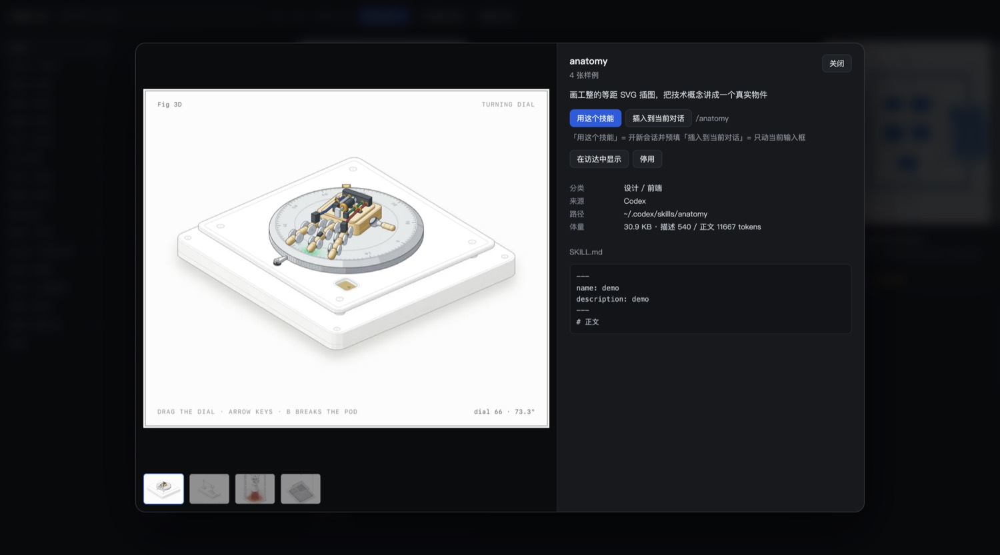

# dsh-skill-atlas

A sidebar panel for [DeepSeek Harness](https://github.com/deepseek-ai/deepseek-harness) that turns your installed skills into cards you can actually browse, and starts a new session with the chosen skill prefilled.

Installed a few hundred skills and now you cannot remember which one to use? That is the problem this plugin answers.

> **It ships no skill data.** Everything you see comes from your own machine. The plugin only reads `SKILL.md` files, classifies them, and renders them.




## What it does

| | |
|---|---|
| **One place for every skill** | Scans `~/.dsh/skills`, `~/.agents/skills`, `~/.codex/skills`, `~/.codex/plugins`, `~/.claude/skills`, skills shipped inside installed plugins, and each workspace's `.dsh/skills` |
| **Cards, not a file tree** | Name, one-line summary, category, sample count, git revision, disabled state |
| **16 capability categories** | Deck / video / audio / image / design / docs / writing / data / game / code / agent / ops / platform / career / thinking / other |
| **Family collapse** | 20 `artifact-template-*` or 29 `seedance-*` cards would flood the page; families of 6+ collapse into one card that expands on click, and auto-expands while you search |
| **Samples on the card** | If a skill ships example images, the card shows a cover; deck cards use a 16:9 frame, video a poster with a play state, image a 4:5 frame. Click any card to open a full-size preview with thumbnails |
| **Use it, don't install it** | “用这个技能” calls the host's `uiWorkspace.startSession` and opens a **new session** with `/skill-name ` prefilled. “插入到当前对话” only touches the composer you are already looking at |
| **Masonry layout** | Mixed 16:9 and 4:5 cards flow without overlap |
| **Search, filter, sort** | Full-text search over name and summary, category rail, “only skills with samples”, and usage-first ordering (click counts stay in `localStorage`) |

## Install

From GitHub (no build step, plain JavaScript):

```sh
dsh plugin --profile web add github:logic0512/dsh-skill-atlas
```

Replace `web` with your profile name. On the desktop app, open **Plugins → Add plugin** and paste:

```
github:logic0512/dsh-skill-atlas
```

Then restart the Harness process and refresh the page. A **技能大全 / Skill Atlas** entry appears in the sidebar panel list.

## How it reads your skills

For every directory containing a `SKILL.md`, the plugin parses the YAML frontmatter (`name`, `description`, `disable-model-invocation`) and computes size, token estimates and git revision. Same-name copies across roots are merged into one card, with the extra locations listed in the detail view.

Without a catalog file it classifies by keywords on the name first, then the description (name hit = strong signal, first 120 characters = medium, rest = weak). That is decent but not perfect — which is what the optional catalog is for.

## Optional: your own catalog

If you want Chinese summaries, corrected categories, or attached sample images, put a catalog at:

```
$DSH_HOME/skill-atlas/catalog.json
```

The plugin merges it over the scan: entries found there win, everything else falls back to keywords. See [docs/CATALOG.md](docs/CATALOG.md) for the format and a suggested workflow for building one.

Sample images are served from disk through the host, never copied into the plugin.

## Safety

- Scanning is read-only. The plugin never edits a skill directory on its own.
- The only writes are explicit actions in the detail view: **停用/启用** (rewrites `disable-model-invocation` in `SKILL.md`, leaving a `SKILL.md.atlas-bak` backup first) and **检查更新 / 更新** (`git fetch` then `git pull --ff-only`, refused when the repo has uncommitted changes).
- Every HTTP route validates the request against the scan result and returns 404 for an unknown id; no arbitrary path is ever served.
- Sample images are size-capped and must be `png`/`jpg`/`webp`/`gif`.

## Development

No build step. The client is plain `React.createElement`, loaded by the host through `__ModuleLoader__`.

```sh
node --check index.js && node --check client.js
node test/host-smoke.mjs      # runs against a throwaway DSH_HOME
```

`test/host-smoke.mjs` covers the whole host flow: scan, read, toggle on/off, install to a workspace, uninstall, and rejection of unknown ids.

Layout:

```
index.js            host: scanning, classification, git, /skill-atlas/* routes
client.js           web: sidebar entry, card grid, modal
cordis.patch.yml    bundle mount point
tools/dump-catalog.mjs   dump the current scan as a catalog skeleton
docs/CATALOG.md     catalog format and how to build one
```

## License

MIT
