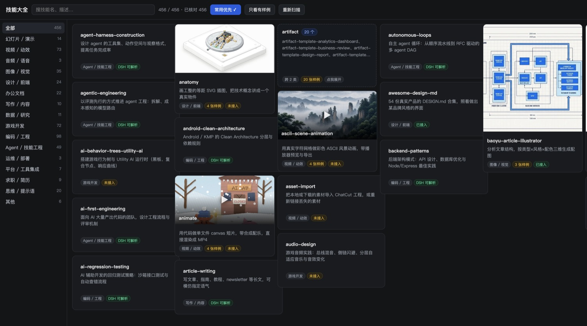

# dsh-skill-atlas

**Your skills live in more than one place.**

Claude Code, Codex, Cursor, WorkBuddy — every agent keeps its own skills directory. A few hundred `SKILL.md` files end up scattered across a dozen folders, and once installed they are forgotten.

This plugin pulls all of them into one sidebar in DeepSeek Harness: **scan → deduplicate and classify → preview → use.**



[简体中文](README.zh-CN.md)

## What it does

| | |
|---|---|
| **Scan everything** | `~/.dsh/skills`, `~/.agents/skills`, `~/.codex/skills`, `~/.codex/plugins` (including cached and nested skills), `~/.claude/skills`, skills bundled by installed plugins, plus each workspace's `.dsh/skills` and `.agents/skills`. On one real machine: **456 skills across 13 roots** |
| **Deduplicate and classify** | 136 duplicate copies merged into single cards, 16 capability categories, and same-prefix families (20 `artifact-template-*`, 29 `seedance-*`) collapsed into one expandable card that auto-expands while you search |
| **Preview** | A one-line summary, source, size and token cost per skill; covers for skills that ship sample images (16:9 for decks, posters for video, 4:5 for images), click to enlarge and step through samples |
| **Use** | "用这个技能" starts a **new session** with `/skill-name ` prefilled in the composer |

## One thing you should know

DSH resolves `/skill-name` only inside these roots (source: `roots()` in `dsh-skill-filesystem`):

```
<workspace>/.dsh/skills      <workspace>/.agents/skills
~/.dsh/skills                ~/.agents/skills
plugin-bundled skills        custom directories
```

**`~/.codex/skills` and `~/.claude/skills` are not among them.** Scanning a skill does not make it callable.

On that same 456-skill machine:

```
directly callable   221
needs linking       235   (all under ~/.codex)
```

So every card carries one of three states:

| State | Meaning | What you can do |
|---|---|---|
| **可直接调用** | Already inside a DSH root | Start a session with it |
| **已接入** | The plugin symlinked it into `~/.dsh/skills` | Same, and you can unlink it again |
| **未接入** | Only present in another agent's folder | "接入 DSH" creates a symlink |

**Linking creates a symlink, never a copy.** No duplicated bytes, the source directory is untouched, edits show up immediately, and removing the link undoes it. It is exactly what you would do by hand in `~/.dsh/skills`, minus the manual work.

## Install

```sh
dsh plugin --profile web add github:logic0512/dsh-skill-atlas
```

Replace `web` with your profile name. In the desktop app: **Plugins → Add plugin**, paste `github:logic0512/dsh-skill-atlas`.

Restart the Harness process afterwards; the **Skill Atlas** entry appears in the sidebar.

## Optional: your own catalog

The plugin ships no skill data. Out of the box it classifies by keywords, but summaries, corrected categories and sample images are yours to define. Drop a catalog at `$DSH_HOME/skill-atlas/catalog.json`:

```json
[{
  "name": "guizang-ppt-skill",
  "category": "deck",
  "zh": "做横向翻页网页 PPT：电子杂志或瑞士风，带讲者视图与讲稿",
  "repo": "https://github.com/op7418/guizang-ppt-skill",
  "samples": ["/Users/me/.dsh/skill-atlas/samples/guizang-ppt-skill/0.png"]
}]
```

Format and workflow: [docs/CATALOG.md](docs/CATALOG.md), including the three traps worth knowing — a skill named `video-downloader` is not a video producer, app icons and QR codes masquerade as sample images, and two skills can end up sharing one cover.

## Safety

- Scanning is read-only. Skill directories are never modified by the scan.
- The only writes are explicit actions you trigger:
  - **Link / unlink** — create or remove one symlink in `~/.dsh/skills` (the target is verified to point at that exact skill before removal)
  - **Disable / enable** — rewrite `disable-model-invocation` in `SKILL.md`, after saving `SKILL.md.atlas-bak`
  - **Check for updates / update** — `git fetch`, then `git pull --ff-only`, refused when the repo has uncommitted changes
- Every route validates the id against the scan result and returns 404 otherwise; no arbitrary path is ever served.
- Sample images are size-capped and restricted to png/jpg/webp/gif.

## Development

No build step. The client is plain `React.createElement`, loaded through the host's `__ModuleLoader__`.

```sh
node --check index.js && node --check client.js
node test/host-smoke.mjs      # runs against a throwaway DSH_HOME
```

The smoke test covers scanning, reading `SKILL.md`, enable/disable, link/unlink, workspace install, and rejection of unknown ids.

```
index.js                 host: scanning, classification, git, /skill-atlas/* routes
client.js                web: sidebar entry, card grid, modal
cordis.patch.yml         bundle mount point
tools/dump-catalog.mjs   dump the current scan as a catalog skeleton
docs/CATALOG.md          catalog format and how to build one
```

## License

MIT
