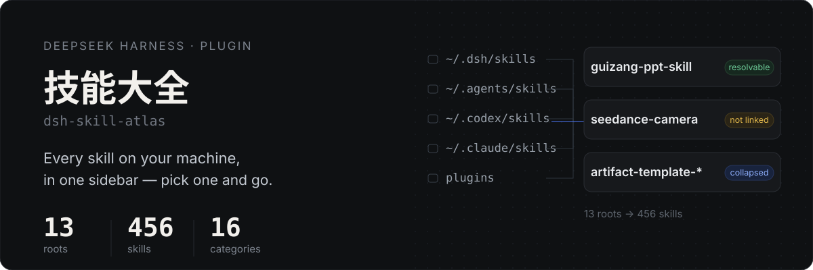
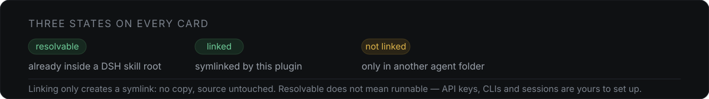

<p align="center">
  
</p>

<p align="center">
  <a href="README.zh-CN.md">简体中文</a> ·
  <a href="#install">Install</a> ·
  <a href="#what-it-guarantees-and-what-it-does-not">Limits</a>
</p>

Your skills are not all in one place. Claude Code, Codex, Cursor and WorkBuddy each keep their own folder, and after a few months nobody remembers what is installed where.

This plugin scans all of those folders, turns every `SKILL.md` into a card in a DeepSeek Harness sidebar, and lets you start a new session with the skill prefilled — **including the ones DSH cannot see on its own.**


## What it does

- **Scans everywhere** — `~/.dsh/skills`, `~/.agents/skills`, `~/.codex/skills`, `~/.codex/plugins`, `~/.claude/skills`, skills bundled by installed plugins, and each workspace's `.dsh/skills` / `.agents/skills`. Measured on one machine: 456 skills across 13 roots.
- **Makes sense of it** — 136 duplicate copies merged, 16 capability categories, and same-prefix families (20 `artifact-template-*`, 29 `seedance-*`) collapsed into one expandable card.
- **Shows what it looks like** — a one-line summary, source, size and token cost; covers for skills that ship sample images (16:9 decks, video posters, 4:5 images), click to enlarge.
- **Puts it to work** — “用这个技能” opens a new session with `/skill-name ` already in the composer.

## Card states

<p align="center">
  
</p>

DSH resolves `/skill-name` only inside its own skill roots. `~/.codex/skills` and `~/.claude/skills` are **not** among them, so on that 456-skill machine 221 were directly resolvable and 235 were not. For those, one click in the detail view creates a **symlink** into `~/.dsh/skills` — no copy, source untouched, removable at any time.

## What it guarantees, and what it does not

**Guaranteed:** scanning, deduplication, classification, path recording, reading `SKILL.md`, and linking. These are deterministic and independent of your setup.

**Not guaranteed:** that an invoked skill works. Three things decide that:

1. Is it inside a DSH root — the one part this plugin handles
2. Does it need external prerequisites — API keys, CLI tools, packages, third-party accounts or a logged-in session. These are described inside `SKILL.md`; the plugin neither reads nor configures them
3. Did you set them up

Real cases: the `seedance-20` family needs a Seedance key, `playwright-scraper-skill` needs Chromium, `xiaohongshu-ops` needs a logged-in browser profile. Whether a skill resolves is a different question from whether its dependencies are ready.

So the plugin answers one question: **which skills are on this machine, where they live, and roughly what they do.**

## Install

```sh
dsh plugin --profile web add github:logic0512/dsh-skill-atlas
```

Replace `web` with your profile name. In the desktop app: **Plugins → Add plugin**, paste `github:logic0512/dsh-skill-atlas`, then restart the Harness process.

## Optional: your own catalog

The plugin ships no skill data. Out of the box it classifies by keywords; summaries, corrected categories and sample images are yours to define at `$DSH_HOME/skill-atlas/catalog.json`:

```json
[{
  "name": "guizang-ppt-skill",
  "category": "deck",
  "zh": "做横向翻页网页 PPT：电子杂志或瑞士风，带讲者视图与讲稿",
  "repo": "https://github.com/op7418/guizang-ppt-skill",
  "samples": ["/Users/me/.dsh/skill-atlas/samples/guizang-ppt-skill/0.png"]
}]
```

Format and workflow: [docs/CATALOG.md](docs/CATALOG.md) — including the three traps: a skill named `video-downloader` is not a video producer, app icons and QR codes pose as sample images, and two skills can end up sharing one cover.

## Safety

Scanning is read-only. Three explicit actions write anything:

| Action | What it touches |
|---|---|
| Link / unlink | one symlink in `~/.dsh/skills`; removal verifies the target first |
| Disable / enable | `disable-model-invocation` in `SKILL.md`, after writing `SKILL.md.atlas-bak` |
| Check / apply update | `git fetch`, then `git pull --ff-only`; refused when the repo is dirty |

Every route validates the id against the scan result and returns 404 otherwise — no arbitrary path is ever served. Sample images are size-capped to png/jpg/webp/gif.

## Development

No build step. The client is plain `React.createElement`, loaded through the host's `__ModuleLoader__`.

```sh
node --check index.js && node --check client.js
node test/host-smoke.mjs      # runs against a throwaway DSH_HOME
```

```
index.js                 host: scanning, classification, git, /skill-atlas/* routes
client.js                web: sidebar entry, card grid, modal
cordis.patch.yml         bundle mount point
assets/readme/           hero and states SVGs (zh + en)
tools/dump-catalog.mjs   dump the current scan as a catalog skeleton
docs/CATALOG.md          catalog format and how to build one
```

## License

MIT
