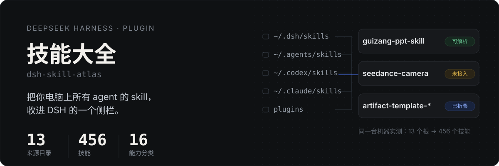
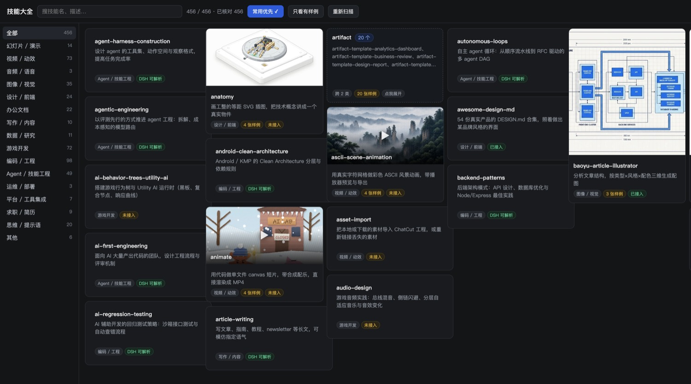
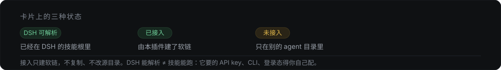

<p align="center">
  
</p>

<p align="center">
  <a href="README.md">English</a> ·
  <a href="#安装">安装</a> ·
  <a href="#能保证什么不能保证什么">边界</a>
</p>

你的 skill 从来不在一个地方。Claude Code、Codex、Cursor、WorkBuddy 各存各的，几个月后就没人记得装过什么、装在哪。

这个插件把那些目录全扫一遍，把每个 `SKILL.md` 变成 DSH 侧栏里的一张卡，选中就能开新会话——**包括 DSH 自己看不见的那些**。



## 它做什么

- **扫全** —— `~/.dsh/skills`、`~/.agents/skills`、`~/.codex/skills`、`~/.codex/plugins`、`~/.claude/skills`、各插件自带技能、每个工作区的 `.dsh/skills` 与 `.agents/skills`。一台机器实测：13 个根，456 个技能。
- **理清** —— 合并 136 份重复副本，按「产出什么」分成 16 个能力分类；同前缀的大家族（20 个 `artifact-template-*`、29 个 `seedance-*`）折成一张可展开的卡。
- **看懂** —— 一句中文定位、来源、体积、token 开销；有案例图的直接上图（幻灯片 16:9、视频海报、图片 4:5），点开可放大。
- **用起来** —— 点「用这个技能」，开新会话并把 `/技能名` 预填进输入框。

## 卡片上的三种状态

<p align="center">
  
</p>

DSH 解析 `/skill-name` 时只认自己的技能根，`~/.codex/skills` 和 `~/.claude/skills` 都不在里面。所以同一台 456 个技能的机器上，能直接解析 221 个，另外 235 个不行。对后者，详情里点一下就能在 `~/.dsh/skills` 建一个**软链**——不复制、不改源目录、随时可删。

## 能保证什么，不能保证什么

**保证**：扫描、去重、分类、记录路径、读取 `SKILL.md`、接入。这些是确定性的，跟你的环境无关。

**不保证**：调用了就一定跑得通。取决于三件事：

1. 在不在 DSH 的技能根里 —— 这一件插件能帮你做
2. 它有没有外部依赖 —— API key、CLI 工具、依赖包、第三方账号或登录态。这些写在 `SKILL.md` 里，插件不读也不配
3. 你配没配

真实例子：`seedance-20` 系列要 Seedance 的 key，`playwright-scraper-skill` 要 Chromium，`xiaohongshu-ops` 要已登录的浏览器 profile。**能不能解析**和**依赖配没配**，是两件事。

所以这个插件只回答一个问题：**你机器上到底有哪些技能、在哪个目录、大概干什么。**

## 安装

```sh
dsh plugin --profile web add github:logic0512/dsh-skill-atlas
```

把 `web` 换成你的 profile 名。桌面版：**插件 → 添加插件**，粘贴 `github:logic0512/dsh-skill-atlas`，然后重启 Harness 进程。

## 可选：自己的目录文件

插件不自带任何技能数据。默认按关键词分类；中文定位、准确分类、案例图由你自己定，放在 `$DSH_HOME/skill-atlas/catalog.json`：

```json
[{
  "name": "guizang-ppt-skill",
  "category": "deck",
  "zh": "做横向翻页网页 PPT：电子杂志或瑞士风，带讲者视图与讲稿",
  "repo": "https://github.com/op7418/guizang-ppt-skill",
  "samples": ["/Users/me/.dsh/skill-atlas/samples/guizang-ppt-skill/0.png"]
}]
```

格式与做法见 [docs/CATALOG.md](docs/CATALOG.md)，里面写了三个坑：名字像视频其实是分析、图标和二维码冒充案例图、两个技能共用一张封面。

## 安全边界

扫描全程只读。只有三个动作会写盘：

| 动作 | 动了什么 |
|---|---|
| 接入 / 断开 | `~/.dsh/skills` 里的一个软链；删除前会核对它确实指向这个技能 |
| 停用 / 启用 | 改写 `SKILL.md` 的 `disable-model-invocation`，改前先存 `SKILL.md.atlas-bak` |
| 检查更新 / 更新 | 先 `git fetch` 再 `git pull --ff-only`，仓库有未提交改动时直接拒绝 |

所有接口都先校验 id 是否在扫描结果里，未知 id 一律 404，不存在任意路径读取；样例图有大小上限，只接受 png/jpg/webp/gif。

## 开发

没有构建步骤，客户端是纯 `React.createElement`，由宿主通过 `__ModuleLoader__` 注入 react。

```sh
node --check index.js && node --check client.js
node test/host-smoke.mjs      # 跑在临时 DSH_HOME 里，不碰真实数据
```

```
index.js                宿主：扫描、分类、git、/skill-atlas/* 路由
client.js               浏览器：侧栏入口、卡片、浮层
cordis.patch.yml        bundle 挂载点
assets/readme/          hero 与 states 的 SVG（中英各一套）
tools/dump-catalog.mjs  把当前扫描导出成目录骨架
docs/CATALOG.md         目录格式与做法
```

## 许可

MIT
